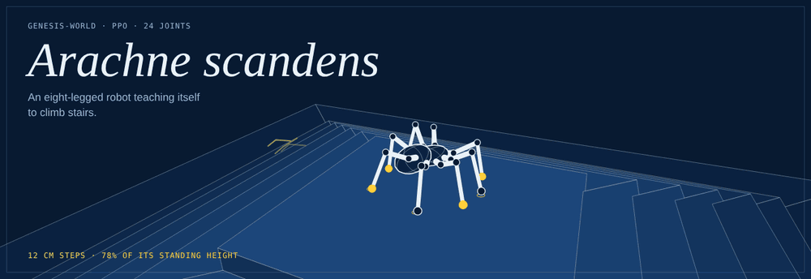
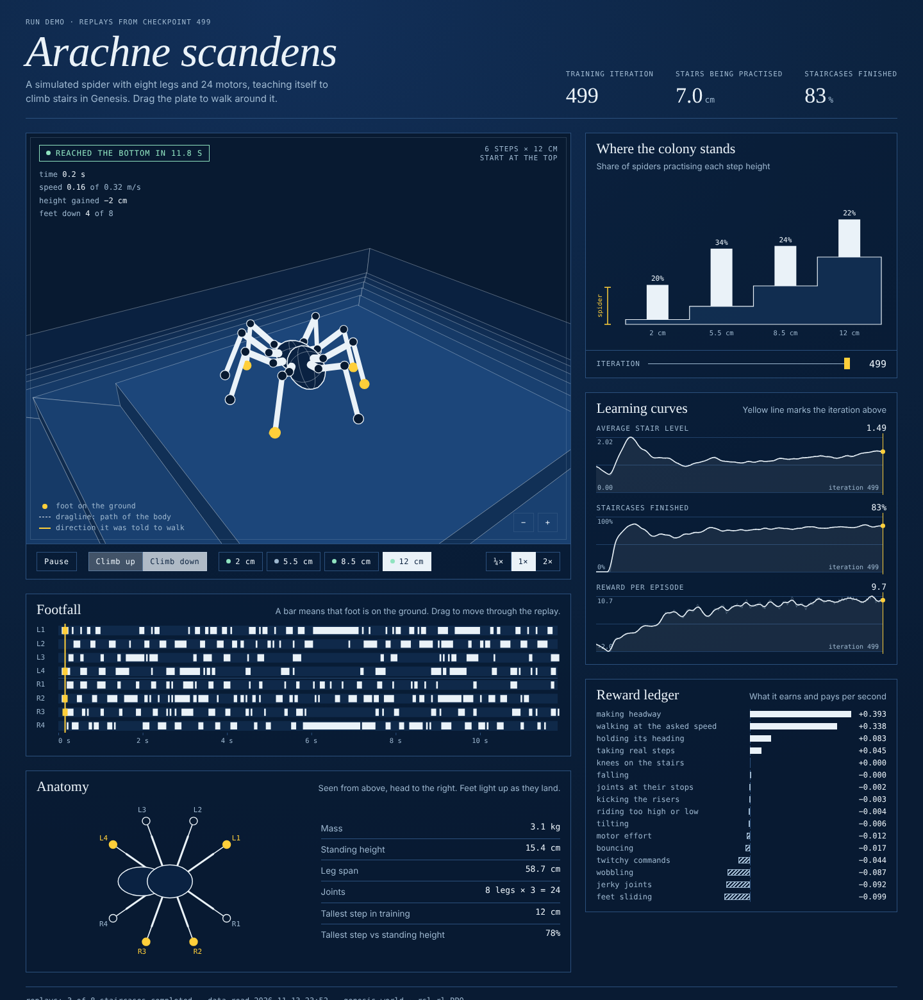

<p align="center">
  
</p>

# spider-stairs

An eight-legged, 24-joint spider that teaches itself to climb stairs. It trains in [Genesis](https://github.com/Genesis-Embodied-AI/genesis-world) with PPO across thousands of parallel simulations, and comes with its own dashboard for watching what it learned.

The banner is a real replay: a policy trained for 30 minutes on two CPU cores, walking down 12 cm steps (78% of its own standing height) with exploration noise switched off.

## Status

| | |
|---|---|
| Robot, terrain, environment, training, dashboard | working, smoke-tested on CPU |
| Demo run (256 spiders, 500 iterations, ~3M steps, CPU) | 83% of training episodes finish their staircase |
| Same policy, noise off, one attempt per staircase | 3 of 8 finished, all descents (2, 8.5 and 12 cm). Ascents get partway and run out of time |
| Full run (4096 spiders, 3000 iterations, GPU) | not run yet |

The demo is about 1% of the planned training budget. It shows that the pipeline learns a real gait; climbing up the tall steps needs the full run.

## Skills used

**Reinforcement learning**
- PPO with an asymmetric actor-critic (the critic sees true velocity, foot contacts, friction and step height; the policy does not)
- Automatic terrain curriculum: promotion and demotion by measured progress
- Reward shaping, including diagnosing and fixing two reward exploits (see [What went wrong first](#what-went-wrong-first))
- Domain randomisation: friction, pushes, sensor noise, action latency

**Robotics and simulation**
- GPU-parallel rigid-body simulation in Genesis
- Procedural robot modelling in MJCF: the spider is generated from a parameter spec, not drawn by hand
- PD joint control, contact-force sensing, forward kinematics for foot positions
- Height-field terrain generation and on-device terrain sampling

**Software engineering**
- Python and PyTorch, vectorised: no per-environment Python loops in the training path
- Config-driven design: behaviour is tuned in one file
- Smoke tests that check the physics (the spider must stand) as well as tensor shapes
- Experiment tooling: TensorBoard log parsing, checkpointing, resumable runs, headless video

**Visualisation and front-end**
- A dependency-free dashboard in one HTML file
- A hand-written 3D renderer on Canvas 2D: perspective projection, back-face culling, depth sorting
- Forward kinematics re-implemented in JavaScript, so replays are drawn from recorded joint angles
- Information design: gait diagrams, a to-scale curriculum chart, a diverging reward ledger

## The dashboard



Download [`docs/demo.html`](docs/demo.html) and open it in a browser to try it with the demo run's data.

- **Plate.** A 3D replay drawn from recorded joint angles. Drag to orbit. Feet turn yellow on contact and leave prints; the dashed line is the path of the body.
- **Footfall.** The gait diagram for the replay, which doubles as the timeline. An alternating pattern across the eight rows is a real gait; solid bars mean it is dragging its feet.
- **Where the colony stands.** The curriculum drawn as a staircase to scale, with the share of spiders practising each step height. Scrub the iteration slider to watch the population move up.
- **Reward ledger.** What each reward term pays or costs per second at the selected iteration.

```bash
python scripts/dashboard.py                    # http://localhost:8000, curves refresh every 15 s while training
python scripts/dashboard.py --record           # replay the latest checkpoint on every staircase, then serve
python scripts/dashboard.py --build run.html   # one self-contained file to share
```

## Run it

Training needs a GPU (NVIDIA with CUDA, or Apple Silicon). A free Colab T4 works.

```bash
pip install genesis-world "rsl-rl-lib>=5.0.0" tensorboard    # plus PyTorch for your platform

python tests/smoke_test.py            # sanity check, runs on CPU in about a minute
python scripts/train.py               # 4096 spiders, 3000 iterations
python scripts/dashboard.py --record  # watch the result

python scripts/play.py --level 7                     # hardest stairs, in the Genesis viewer
python scripts/play.py --level 7 --record climb.mp4  # or record headless
```

On a small GPU use `-b 1024` or `-b 2048`. `--resume N` continues from `model_N.pt`. To reproduce the CPU demo: `python scripts/train.py --cpu -b 256 --small-terrain --max-iterations 500`.

## How it works

**Robot.** 3.1 kg, body 15 cm off the ground, feet on a 55 x 59 cm footprint. Each leg has a hip yaw, a hip pitch and a knee. The default stance holds the knees above the body, which is what lets a leg reach over a riser. Leg count, lengths and masses are parameters in `SpiderSpec`.

**Terrain.** A grid of 6 m tiles. Rows are difficulty levels with step heights from 2 cm to 12 cm. Columns are tile types:

- `ascend`: a pit. The spider starts on the floor and climbs up six steps to the rim.
- `descend`: a pyramid. It starts on the summit and climbs down.

Steps are square rings, so every walking direction meets a staircase and diagonal headings cross the corners.

**Curriculum.** Each spider is told to walk in a random direction. Reach the far end of the staircase and it moves up a level; fail to get halfway and it moves down. Graduates of the hardest level are recycled to random levels.

**Observations (158).** Body angular velocity, gravity direction, command, 24 joint positions, 24 joint velocities, previous action, and an 11 x 7 terrain height scan around the body.

**Actions (24).** Joint position targets around the default stance, tracked by PD control at 200 Hz. The policy runs at 50 Hz with one step of latency.

**Rewards.** Speed and heading tracking drive the task. Light penalties on bounce, tilt and ride height keep the body stable without forbidding the pitching that climbing needs. `feet_air_time` pays for real steps, `feet_slip` and `feet_stumble` penalise sliding feet and legs hitting risers side-on, `collision` penalises knees touching the stairs, and body contact ends the episode.

## What went wrong first

Neither problem was visible in the training curves. Both showed up only in replays.

1. **It learned to stand still.** The standard velocity-tracking kernel is tuned for quadrupeds that run at 1 m/s. This spider walks at 0.25 to 0.6 m/s, so standing motionless already earned 53 to 78% of the reward. Fix: a kernel five times tighter, plus a dense `forward_progress` term.
2. **It learned to vibrate.** Success in training reached 81%, but with exploration noise off the spider moved at 0.01 m/s. The policy had found that random joint jitter ratchets a light eight-legged body forward on friction, so the noise was doing the walking. Fix: a `feet_slip` penalty on planted feet that slide, and a lower initial action noise. The gait in the banner is the result.

## Layout

```
spider-stairs/
├── assets/spider.xml          generated robot model (MJCF)
├── spider_stairs/
│   ├── robot.py               procedural spider
│   ├── terrain.py             stair curriculum height field
│   ├── env.py                 parallel environment, observations, rewards, curriculum
│   ├── config.py              every tunable: PD gains, rewards, noise, PPO hyperparameters
│   └── uidata.py              reads training logs and records replays for the dashboard
├── scripts/
│   ├── train.py               PPO training (rsl-rl)
│   ├── play.py                viewer rollout or mp4 recording of a checkpoint
│   └── dashboard.py           serves the dashboard, records replays, builds a shareable file
├── ui/index.html              the dashboard: one file, no build step
├── docs/                      banner, screenshot, demo page
└── tests/smoke_test.py        CPU check that the sim and env are sane
```

## Tuning notes

- `Episode/terrain_level` is the real progress metric. Mean reward can dip while the level rises, because harder stairs pay less.
- Always judge a checkpoint with noise off (`play.py` and the dashboard both do). Training success alone can mislead, as above.
- If it stalls at one level, look at `rew_feet_stumble` and `rew_collision`: high values mean legs are catching on risers. Widening `scan_x` forward or raising `action_scale` helps.
- If the gait is jittery, raise the `action_rate` and `dof_acc` penalties.

## Next

- Full GPU training run, and replays of the 12 cm ascent
- A foot-clearance reward tied to the height of the next riser
- Remove the height scan from the policy and learn to feel the stairs from joint feedback alone

## Tested with

genesis-world 1.4.6, rsl-rl-lib 5.5.2, torch 2.15, Python 3.13.
